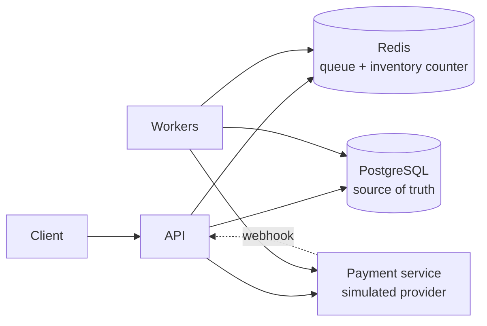
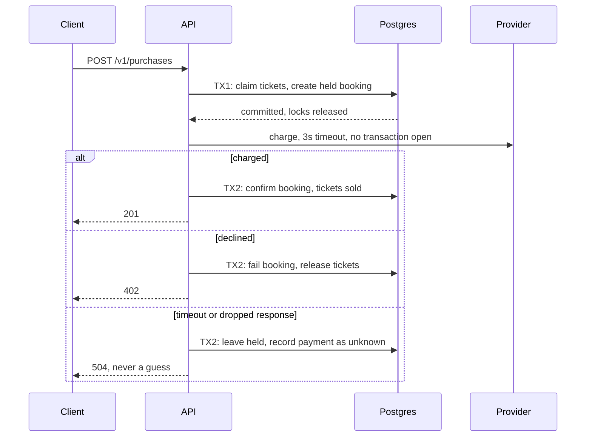
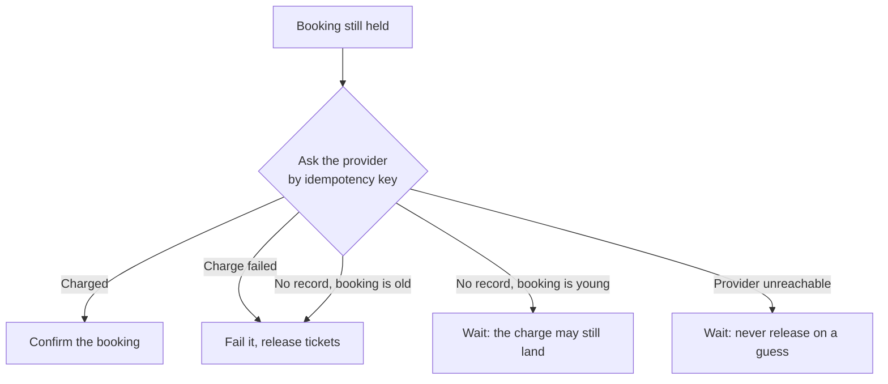
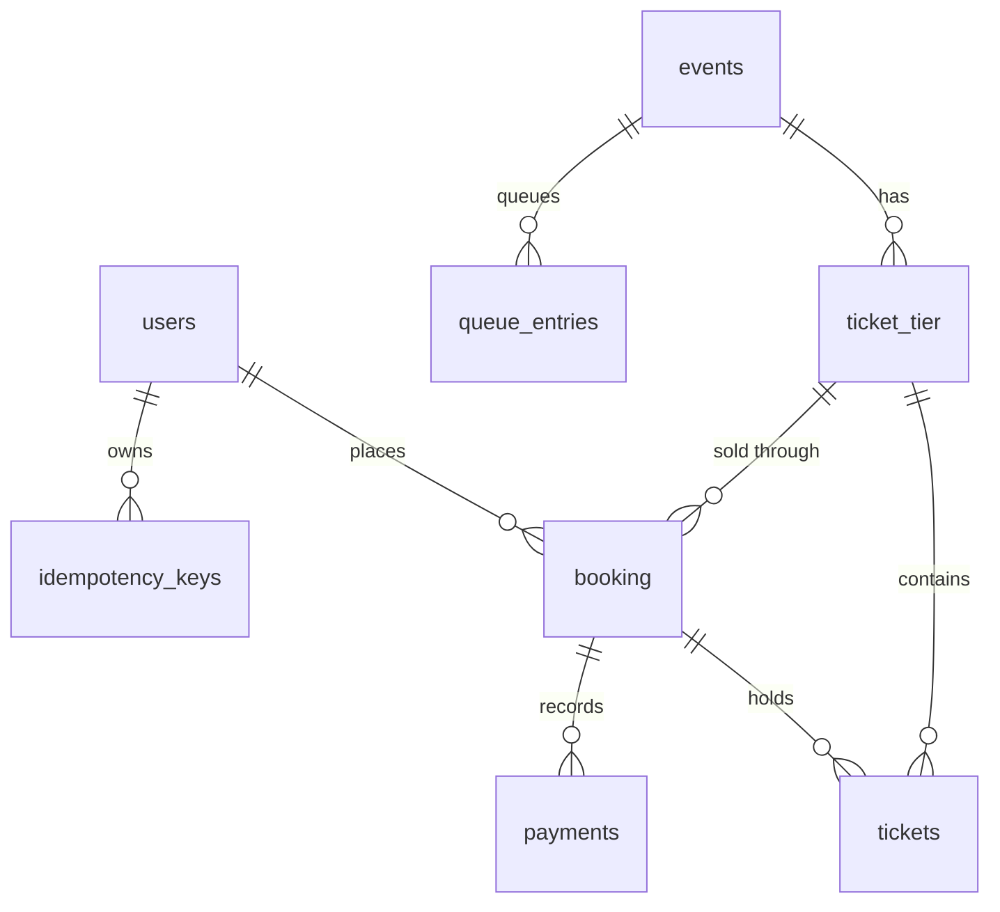

# TicketQueue

A ticket booking backend in Go, built around one question: **what happens to the
money when the network fails halfway through a purchase?**

It guarantees no overselling under heavy concurrency and no double charges under
network failure. When it cannot know whether a customer was charged, it refuses
to guess, and resolves the booking later by asking the payment provider.

**[Watch replays of two real runs](https://vinhpnguyen123.github.io/ticketqueue/)**

| Result | Measured |
|---|---|
| **Overselling** | 2,000 concurrent buyers, 100 tickets: exactly 100 sold, 0 oversold |
| **Provider outage** | Down for 90s: 500 bookings frozen, 0 tickets released on a guess, all resolved within 39s of recovery |
| **API crash mid-load** | Stranded bookings recovered with no user action and no money discrepancy |
| **Lost payment response** | Card charged, response dropped: booking confirmed by the worker in about 2 minutes, charged exactly once |

All of this ran on one laptop, against a simulated payment provider. Raw results
and their limits are in [docs/load-test-results.md](docs/load-test-results.md).

## The hard problem

A customer pays, the provider charges the card, and the response is lost.

- Guess "it failed" and you release tickets the customer paid for.
- Guess "it worked" and you hand out tickets nobody paid for.

TicketQueue does neither. The booking stays `held` as durable evidence, the API
answers `504 payment_processing_unclear`, and a worker later asks the provider
what really happened, using the idempotency key sent with the original charge.

```bash
make demo   # runs this exact scenario and prints the audit trail
```

Walkthrough: [docs/demo.md](docs/demo.md).

## Architecture



**Postgres is truth, Redis is speed.** Anything in Redis can be rebuilt from
Postgres, and promotion, purchases and position checks all keep working without
it. There are three binaries: the API, one worker process running five loops, and
a payment simulator that can inject timeouts and dropped responses, which a real
provider's sandbox cannot do on demand.

## The purchase flow

No database transaction is ever held open across the payment call.



## How a stuck booking resolves



Every finalize path (the purchase, both workers, the admin endpoint, the webhook,
and a client reading its booking) goes through the same resolver, so this logic
exists once. Frozen inventory is recoverable. A customer charged without a ticket
is not, so that is the failure the system refuses to risk.

## 13 problems this solves

| # | Problem | Approach |
|---|---|---|
| 1 | Overselling under concurrency | Three layers: Redis Lua fast reject, `FOR UPDATE SKIP LOCKED` on ticket rows, and a structural guard, since each ticket row holds one booking |
| 2 | Double charge on retry | HTTP idempotency keys that replay the stored response, plus a separate per-booking key for the provider |
| 3 | Money moved but the response was lost | Durable `held` state and a reconciliation worker |
| 4 | Locks held across network calls | Two transactions with the payment call between them |
| 5 | Concurrent duplicate requests | Atomic key claim, and a unique index allowing one held booking per user |
| 6 | Traffic spikes at sale time | Queue admission with a capped number of purchase windows |
| 7 | Losing the queue when Redis dies | Admission reads Postgres; a worker repairs Redis every 60s |
| 8 | Redis and Postgres drifting apart | Drift checker with two-cycle confirmation and compare-and-set repair |
| 9 | Releasing tickets during a provider outage | Hold expiry asks the provider first and defers if it cannot |
| 10 | Charged after the booking already failed | Recorded, audited and surfaced to admins for refund |
| 11 | Disputes weeks later | Append-only `audit_log` that outlives what it describes |
| 12 | Payment racing hold expiry | Guarded updates: the first writer wins, the loser sees zero rows |
| 13 | Knowing what actually limits throughput | Prometheus phase timings and measurement, which disproved the first theory |

## What the numbers showed

- **The bottleneck was not what it looked like.** The connection pool sat pinned
  at its limit, so I raised it fivefold. Throughput did not change. The pool was
  the queue; Postgres CPU was the wall.
- **Throughput:** about 360 purchases/s at 500 concurrent users on a laptop, with
  zero errors up to 8,000. At 10,000 the OS dropped 16.5% of connections, and the
  app still sold exactly the right number of tickets.
- **Open question:** after the final review fixes, a 5-run comparison gave medians
  of 260 and 230 purchases/s, too noisy on a laptop to call. No cause was found,
  and it needs re-measuring on separate hardware.

## Schema

Nine core tables, with [migrations](migrations) as the source of truth.



`audit_log` deliberately has no foreign keys, so it outlives what it describes.
Money is always integer cents plus a currency code. Tickets are pre-created rows,
never a counter, which is what makes the row-level guarantees possible.

## Run it

Requires Go, Docker, the [`migrate`](https://github.com/golang-migrate/migrate) CLI
and `jq`. [k6](https://k6.io) is needed only for load tests.

```bash
make up && make migrate-up && make seed

make run-payments   # terminal 1
make run            # terminal 2, API on localhost:8081
make run-worker     # terminal 3

make demo           # terminal 4
```

```bash
make create-test-db && make migrate-test-up
make test && make test-integration
```

Load and chaos scenarios: [scripts/k6/README.md](scripts/k6/README.md) and
[docs/chaos/README.md](docs/chaos/README.md). Every pull request runs lint, build,
unit and integration tests, and Terraform validation.

## Privacy and security

- **No card data.** Only a provider token is sent, and only the brand and last four
  digits are stored. This project uses a simulator, so no real payment ever occurs.
- **Passwords** are hashed with argon2id. Login does not reveal whether an email exists.
- **Logs** never include passwords, hashes, payment tokens or Authorization headers.
- **Access:** user ids come only from the JWT, and another user's booking answers
  404. Webhooks are verified by HMAC over the timestamp and body.
- **Secrets:** the app refuses to start without a private JWT secret.

## Honest limits

What would need to change before real traffic:

- **Simulated provider.** The ledger is in memory, so restarting it forgets charges.
  It mirrors Stripe's contract, so a real provider should be an adapter change.
- **Not deployed.** Terraform for AWS is written and validated, but has not been applied.
- **Single-machine benchmarks.** The load generator shared the laptop with the
  server, so the numbers are relative, not capacity claims.
- **No automatic refunds.** A charge on a failed booking is recorded and surfaced,
  but a person resolves it.
- **No anti-scalping.** Rate limiting is coarse. Bot detection and fraud scoring
  are out of scope.
- **Audit writes are synchronous** and cost measurable database time. Production
  would use an outbox.

## Stack

Go, chi, pgx, go-redis, PostgreSQL, Redis, Docker Compose, Prometheus, Grafana,
k6, Terraform, GitHub Actions. Raw SQL throughout, no ORM.

The [demo page](site) is plain HTML and JavaScript. It replays a recording made by
[scripts/capture_replay.py](scripts/capture_replay.py), so every number on it comes
from a real run.
